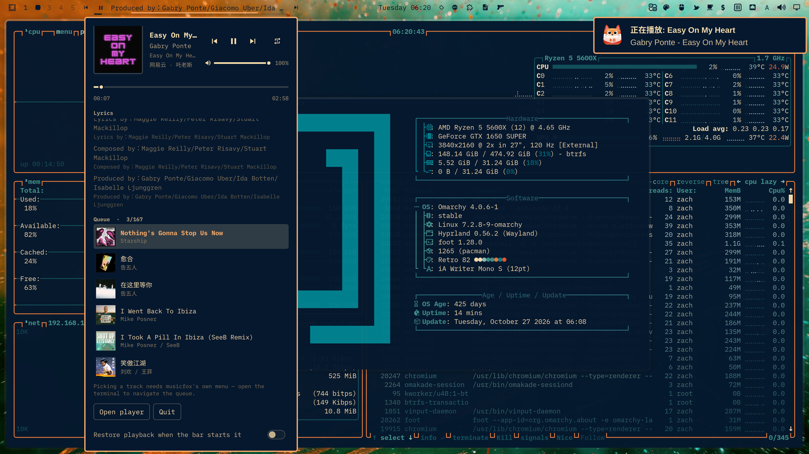

# Musicfox Control for Omarchy

A now-playing bar widget and panel for [musicfox](https://github.com/go-musicfox/go-musicfox),
the terminal NetEase Cloud Music player. It drives the running player over MPRIS,
so there is no fork, no patch, and no second copy of your library.



## What you get

- **Bar line** — previous / play-pause / next plus the line you are actually
  hearing. musicfox
  publishes a full timed lyric over MPRIS, so the bar can scroll the current lyric
  and its translation instead of a static title. A hairline progress track sits
  underneath.
- **Panel** — artwork, title/artist/album, seek bar, volume, the scrolling lyric
  with translations, and the next few tracks in the queue — each with its album
  cover, so the list is scannable rather than a wall of text. Transport
  (previous / play-pause / next / single-loop) sit in one row to the right of
  the artwork, with the volume slider directly beneath them — the whole control
  surface reads as one block level with the cover.
- **Account state** — reads your NetEase nickname from musicfox's own database, so
  you can see at a glance whether you are logged in.
- **Keyboard-first** — arrows/hjkl move, space or enter activates, `p` cycles the
  play mode, `r` re-reads the queue, escape closes. Same idiom as `omarchy.audio`.

## Requirements

| | |
|---|---|
| musicfox | 5.1.0 or newer, `player.engine = "mpv"` — see below |
| tmux | used to host the player and to send it keystrokes |
| python3 | reads the queue out of musicfox's bbolt database |
| Omarchy | shell with third-party plugin support (`~/.config/omarchy/plugins/`) |

### `player.engine` must be `mpv`

musicfox's default engine on Linux is `beep`. Under beep, MPRIS `Pause`, `Next`
and `Stop` reach a nil timer and **crash the whole process**:

```
utils/timex.(*Timer).Pause(0x0)
  ← beepPlayer.pausedNoLock      (beep_player.go:399)
  ← Player.handleControlSignal   (player.go:625)
```

The panel detects this and shows a warning instead of pretending to work, but the
fix is one line:

```toml
# ~/.config/go-musicfox/config.toml
[player]
engine = "mpv"
```

The panel can also toggle this for you (`Restore playback when the bar starts it`),
and reads the setting to decide whether to warn.

## Install

```bash
git clone <this-repo> ~/Workspace/omarchy-music-fox-control
~/Workspace/omarchy-music-fox-control/dev/install.sh
omarchy restart shell
```

`dev/install.sh` copies the tree into `~/.config/omarchy/plugins/io.github.musicfox.control`,
validates the manifest, and adds both the bar entry and the panel registration to
`~/.config/omarchy/shell.json`. It places the widget in the **left** section by
default; re-running it moves an entry that landed elsewhere rather than leaving a
duplicate. Re-run it after editing; plugin QML hot-reloads.

## Using it

The bar shows previous / play-pause / next: each is its own click target, so the
bar's hit test routes a click to the button under the cursor. On the play button,
left click toggles playback (and starts the player if it is not running), right
click opens the panel, middle click skips (configurable), wheel changes volume
(configurable). Everything is setting-driven from the bar entry in `shell.json`:

```json
{ "id": "io.github.musicfox.control", "barMode": "Lyric", "wheelAction": "seek" }
```

To move it somewhere else:

```bash
omarchy bar move io.github.musicfox.control --section right
```

| setting | default | |
|---|---|---|
| `barMode` | `Title` | `Icon`, `Title`, `Artist · Title`, `Lyric` |
| `showLyricInBar` | `true` | prefer the current lyric over the title |
| `maxLabelWidth` | `440` | pixel budget for the lyric/title; longer text is elided with `…` |
| `middleClick` | `next` | `next`, `previous`, `playPause`, `none` |
| `wheelAction` | `volume` | `volume`, `seek`, `nextPrevious`, `none` |
| `panelWidth` | `380` | |

## How it talks to musicfox

musicfox exposes `org.mpris.MediaPlayer2.musicfox.instance<pid>` with a mostly
complete `Player` interface. Three things about it shaped this plugin, all
measured against 5.1.0 rather than assumed:

**Position is a polling getter, not a notifying property.** Quickshell's
`MprisPlayer.position` issues a synchronous DBus read and never emits
`positionChanged`, so binding to it yields a frozen zero. It is polled every
800 ms while playing, and it is already in **seconds** (MPRIS itself uses
microseconds).

**`LoopStatus` and `Shuffle` are decorative.** Writing them succeeds, reading them
back returns the new value, and playback ignores them entirely — the footer stays
`[顺序播放]`. The real control is the `p` key, so the panel's single-loop toggle
presses `p` and re-reads musicfox's own footer until it sees `[单曲循环]` (or has
tried five times). The cycle is fixed and was measured on 5.1.0:

```
列表循环 → 顺序播放 → 单曲循环 → 列表随机 → 无限随机 → 列表循环
```

so reaching single-loop from random takes three presses — which is why the
toggle *reads back* instead of pressing a fixed number of times.

**`HasTrackList` is a lie.** It reports `true`, but there is no
`/org/mpris/MediaPlayer2/PlayList` object, no `GetTracksMetadata`, and `OpenUri`
is unimplemented. The queue is recovered by reading `playlist_snapshot` out of
`~/.local/share/go-musicfox/db/musicfox.db`. That file is held under an exclusive
bbolt lock, so `scripts/queue.py` never opens it as a database — it scans the raw
bytes and brace-balances the JSON out, which is safe against a live writer.

Because of those gaps the plugin also keeps the player in a tmux session and types
into it. That is how it starts the player at all (musicfox is a bubbletea TUI and
dies with `could not open TTY` when spawned without a terminal) and how it reaches
the controls MPRIS does not have. The session name is only a default: players are
discovered by `pane_current_command`, so a musicfox you started yourself is adopted
and driven just as well.

### Cold start

With nothing loaded, MPRIS `Play()` flips `PlaybackStatus` to `Playing`, publishes
the next track's metadata, and never opens an audio stream — and it stays stuck
there. `Next` keeps swapping metadata without ever producing audio. The TUI's
space key takes musicfox's real start-playback path, so a cold start types space
and everything after that goes over MPRIS.

There is a second, rarer failure: a track whose audio cannot be resolved reports
`Playing` with the position pinned at 0 forever. The plugin samples the position
and, if it has not moved while claiming to play, marks the track stalled (the bar
glyph changes) and skips forward once per track.

## What it deliberately does not do

**Pick a track from the queue.** That means driving the TUI's own menu — entering
playlists, paging, choosing a row — which is a stateful journey with no stable
contract. Automating it would break on any musicfox layout change, so the panel
shows the queue and offers `Open player` to hand you the real thing.

**Log in.** MPRIS does not expose authentication, and the panel does not want your
cookie. It shows whether you are logged in and tells you to do it inside musicfox.

## Files

```
manifest.json      kinds: bar-widget + panel
BarWidget.qml      the bar line
Panel.qml          the popup
Model.qml          MPRIS state, lyric, queue, stall guard
Player.qml         tmux discovery, launch, key injection
Lyrics.js          LRC parsing with translation split-out
scripts/queue.py   reads playlist_snapshot from musicfox's bbolt file
scripts/config.py  reads/writes one key of musicfox's TOML without losing comments
dev/install.sh     sync + register
```

## License

[MIT](LICENSE) © 2026 zheng zhao
